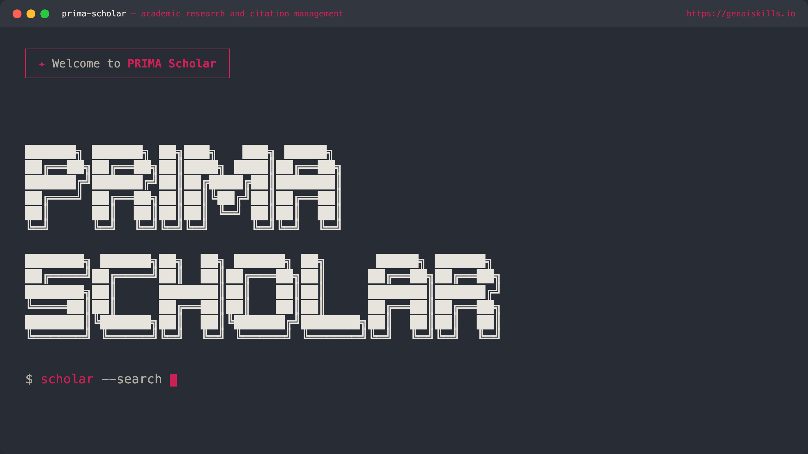

# PRIMA Scholar v2.2.1

A research workspace plugin for [Claude Code](https://docs.anthropic.com/en/docs/claude-code) and [Claude Desktop](https://claude.ai/download). Search 10 academic databases, manage a local document library, and write with properly formatted citations.

## What It Does

- **Academic Search** -- Search PubMed, arXiv, Semantic Scholar, CrossRef, OpenAlex, CORE, Europe PMC, ERIC, bioRxiv/medRxiv, and DBLP from a single interface
- **Search Wizard** -- Analyses your query, detects your discipline, and recommends the best databases to search before you run a query
- **Open Access First** -- Every result shows whether it is open access or gated. OA papers are prioritised in results. Filter to OA-only with a single parameter
- **Full-Text Retrieval** -- Fetch the full text of open access papers from CORE (with a CORE API key), or a download link from Europe PMC, arXiv, and bioRxiv/medRxiv
- **Document Library** -- Import PDFs, Word documents, and text files into a local SQLite database with full-text search, collections, and tagging
- **Multi-Style Citations** -- Generate citations in APA7, Harvard, Chicago, Vancouver, IEEE, and MLA formats
- **Citation Tracking** -- Follow citation chains forward (who cited this paper?) and backward (what does it cite?)
- **Citation-Aware Writing** -- Draft prose with inline citations drawn from your library and search results
- **Research Agents** -- Autonomous multi-step research with cited synthesis, structured form completion from your library and the databases, and a recurring literature watch (see [Agents](#agents-claude-code))

## Databases

| Database | Coverage | Auth | OA Info |
|----------|----------|------|---------|
| **[OpenAlex](https://openalex.org/)** | 250M+ works, all disciplines | No (polite pool with email) | OA status per paper |
| **[PubMed](https://pubmed.ncbi.nlm.nih.gov/)** | Biomedical, life sciences | Optional API key | Varies |
| **[arXiv](https://arxiv.org/)** | Physics, maths, CS, biology, finance, stats | No | All OA (preprints) |
| **[Semantic Scholar](https://www.semanticscholar.org/)** | All disciplines + citation graph | Optional API key | OA status per paper |
| **[CrossRef](https://www.crossref.org/)** | DOI metadata, all disciplines | No (polite pool with email) | OA via licence metadata |
| **[CORE](https://core.ac.uk/)** | 300M+ open access papers | Free API key required | All OA |
| **[Europe PMC](https://europepmc.org/)** | Biomedical + European research council | No | OA status per paper |
| **[ERIC](https://eric.ed.gov/)** | Education research | No | Full text for many |
| **[bioRxiv/medRxiv](https://www.biorxiv.org/)** | Biology and medicine preprints | No | All OA (preprints) |
| **[DBLP](https://dblp.org/)** | Computer science bibliography | No | Metadata only |

## Installation

### Claude Code (Full Plugin)

To install, give your Claude Code instance this repository link and ask it to install PRIMA Scholar. It will handle everything.

> **Instructions for Claude Code (read and follow these steps):**
>
> 1. **Clone to `~/Developer/prima-scholar`** -- not into the current workspace. Cloning inside the workspace creates a nested git repository, which causes git tracking problems and embedded repo warnings on commit. The clone must go to a separate location.
>    ```bash
>    git clone https://github.com/larrygmaguire-hash/prima-scholar.git ~/Developer/prima-scholar
>    ```
>
> 2. **Build both MCP servers:**
>    ```bash
>    cd ~/Developer/prima-scholar/mcp-servers/prima-scholar-search-mcp && npm install && npm run build
>    cd ~/Developer/prima-scholar/mcp-servers/prima-scholar-library-mcp && npm install && npm run build
>    ```
>
> 3. **Run the installer** pointing at the workspace (the directory you are working in):
>    ```bash
>    ~/Developer/prima-scholar/install.sh /path/to/workspace
>    ```
>
> 4. **Restart Claude Code** to load the new commands and MCP servers.

The install script copies commands, skills, agents, and MCP server code into the workspace's `.claude/` directory, registers the MCP servers in `~/.claude.json`, and adds the MCP server directories to the workspace's `.gitignore`. It needs `bash` and `python3` (see [Requirements](#requirements)). The workspace must already have a `.claude/` folder. If `~/.claude.json` does not exist, the script skips registration and you add the servers yourself.

To set API keys on this route, add them to the `env` block of the `prima-scholar-search` entry in `~/.claude.json` (variable names under [Configuration](#configuration)), then restart Claude Code.

### Claude Code Plugin (Load for One Session)

The repository is also laid out as a Claude Code plugin. `.claude-plugin/plugin.json` is the plugin manifest, and `.mcp.json` starts both MCP servers from the plugin folder (`${CLAUDE_PLUGIN_ROOT}/mcp-servers/.../build/index.js`). Claude Code reads the commands, skills, and agents from the `commands/`, `skills/`, and `agents/` folders.

1. Clone the repository and build both MCP servers (steps 1 and 2 above). The servers' `build/` folders are not in the repository, so the plugin cannot start them until you build.
2. Start Claude Code with the plugin folder:
   ```bash
   claude --plugin-dir ~/Developer/prima-scholar
   ```

`--plugin-dir` loads the plugin for that session only, and nothing is copied into your workspace. The repository has no marketplace manifest (`.claude-plugin/marketplace.json`), so it cannot be added with `/plugin marketplace add` or installed with `/plugin install` on its own. Plugin commands and skills carry the plugin name as a prefix, for example `/prima-scholar:scholar`.

On this route the servers take their settings from the environment you start Claude Code in. `.mcp.json` passes all six variables under [Configuration](#configuration): `PUBMED_API_KEY`, `SEMANTIC_SCHOLAR_KEY`, `CORE_API_KEY`, `OPENALEX_MAILTO`, `CROSSREF_MAILTO`, and `RESEARCH_LIBRARY_PATH`. Each is optional. A key or email you have not exported is passed as empty, and `RESEARCH_LIBRARY_PATH` falls back to `~/.research-library/library.db`, so the plugin starts with nothing set. To use a key, export it before you start Claude Code, for example `export CORE_API_KEY=your-key`.

### Claude Desktop (MCP Servers Only)

Add to your Claude Desktop configuration (`claude_desktop_config.json`):

```json
{
  "mcpServers": {
    "prima-scholar-search": {
      "command": "node",
      "args": ["/path/to/prima-scholar/mcp-servers/prima-scholar-search-mcp/build/index.js"],
      "env": {
        "OPENALEX_MAILTO": "your@email.com",
        "CROSSREF_MAILTO": "your@email.com",
        "CORE_API_KEY": "your-core-api-key"
      }
    },
    "prima-scholar-library": {
      "command": "node",
      "args": ["/path/to/prima-scholar/mcp-servers/prima-scholar-library-mcp/build/index.js"],
      "env": {
        "RESEARCH_LIBRARY_PATH": "~/.research-library/library.db"
      }
    }
  }
}
```

You can install either server independently. The search server has no dependency on the library server.

## Updates and Customisation

### Updating

To update, ask your Claude Code instance to update PRIMA Scholar. It will pull the latest version, rebuild, and re-install.

> **Instructions for Claude Code (read and follow these steps):**
>
> 1. **Pull the latest version:**
>    ```bash
>    cd ~/Developer/prima-scholar && git pull
>    ```
>
> 2. **Rebuild both MCP servers:**
>    ```bash
>    cd ~/Developer/prima-scholar/mcp-servers/prima-scholar-search-mcp && npm install && npm run build
>    cd ~/Developer/prima-scholar/mcp-servers/prima-scholar-library-mcp && npm install && npm run build
>    ```
>
> 3. **Re-run the installer:**
>    ```bash
>    ~/Developer/prima-scholar/install.sh /path/to/workspace
>    ```
>
> 4. **Restart Claude Code** to load updated MCP servers.

### What gets overwritten

The installer **overwrites** all PRIMA Scholar commands, skills, and agents on every run. This ensures you always have the latest versions. If you have modified any of the commands, skills, or agents that shipped with PRIMA Scholar, **your changes will be replaced** when you update.

MCP server code is also overwritten on each install. Environment variables and API keys in `~/.claude.json` are preserved: when the installer re-registers a server, it keeps every variable already in that server's `env` block and adds only the defaults that are missing.

### Keeping your customisations

If you want to modify a PRIMA Scholar skill, agent, or command and keep your changes across updates, **copy it to a new name** before editing. The installer only overwrites files that match the exact names it ships -- renamed copies are yours and will never be touched.

> **Instructions for Claude Code:**
>
> When the user asks to customise a PRIMA Scholar skill, agent, or command, copy it to a new name first. Prefix with `my-` or use any name that does not match the original. Examples:
>
> ```bash
> # Customise a skill
> cp -r .claude/skills/researching-topics .claude/skills/my-researching-topics
>
> # Customise an agent
> cp .claude/agents/research-agent.md .claude/agents/my-research-agent.md
>
> # Customise a command
> cp .claude/commands/scholar.md .claude/commands/my-scholar.md
> ```
>
> Edit the copy, not the original. The original will be overwritten on the next update.

## Uninstalling

These steps reverse what `install.sh` does, for a workspace at `/path/to/workspace`. Run them from the workspace folder.

1. **Remove the commands, skills, and agents** the installer copied:
   ```bash
   cd /path/to/workspace
   rm .claude/commands/cite.md .claude/commands/library.md .claude/commands/literature-watch.md .claude/commands/scholar.md
   rm -r .claude/skills/literature-watch .claude/skills/managing-research-library .claude/skills/researching-topics .claude/skills/writing-with-citations
   rm .claude/agents/form-completion-agent.md .claude/agents/literature-watch-agent.md .claude/agents/research-agent.md
   ```
   If you made renamed copies (for example `my-researching-topics`), they are yours and are not part of this list.

2. **Remove the MCP server copies:**
   ```bash
   rm -r .claude/mcp-servers/prima-scholar-search .claude/mcp-servers/prima-scholar-library
   ```

3. **Remove the two server registrations** from `~/.claude.json`. The installer adds them at user scope, so:
   ```bash
   claude mcp remove prima-scholar-search -s user
   claude mcp remove prima-scholar-library -s user
   ```
   This also removes any API keys stored in those entries.

4. **Remove the two `.gitignore` lines** the installer added to the workspace `.gitignore`:
   ```
   .claude/mcp-servers/prima-scholar-search/
   .claude/mcp-servers/prima-scholar-library/
   ```

5. **Restart Claude Code.**

The installer does not create your research library or the literature watch files, so uninstalling leaves them in place. The library is the SQLite file at `RESEARCH_LIBRARY_PATH` (default `~/.research-library/library.db`), plus any `-wal` and `-shm` files beside it; deleting it deletes every document record, tag, and collection. The literature watch config and state are in `.claude/literature-watch/` in the workspace, and digests are in the folder set by `digest_dir`. Delete these only if you no longer want them. You can also delete the clone at `~/Developer/prima-scholar`.

If you used the plugin route, stop starting Claude Code with `--plugin-dir`; nothing was copied into the workspace.

## Configuration

All environment variables are optional except `CORE_API_KEY` (required only if you want to search CORE). The plugin works with zero configuration across the other 9 databases.

| Variable | Purpose | How to Get |
|----------|---------|------------|
| `OPENALEX_MAILTO` | Sent to OpenAlex as `mailto` to join its polite pool. Falls back to `CROSSREF_MAILTO` when `OPENALEX_MAILTO` is unset or empty. The server's own OpenAlex limit stays at 10 req/sec | Use your email address |
| `CROSSREF_MAILTO` | Sent to CrossRef in the User-Agent header to join its polite pool. The server's own CrossRef limit stays at 50 req/sec | Use your email address |
| `PUBMED_API_KEY` | Higher PubMed rate limit (3/sec to 10/sec) | https://www.ncbi.nlm.nih.gov/account/ |
| `SEMANTIC_SCHOLAR_KEY` | Sent to Semantic Scholar as an API key. The server's own Semantic Scholar limit stays at 100 req/5 min | https://www.semanticscholar.org/product/api |
| `CORE_API_KEY` | Required to search CORE (free) | https://core.ac.uk/services/api |
| `RESEARCH_LIBRARY_PATH` | Custom database file location. Unset or empty means the default | Default: `~/.research-library/library.db` |

API keys are stored in your local environment. They are never committed to code or transmitted beyond the API they authenticate with.

## Citation Styles

PRIMA Scholar supports multiple academic citation formats. Specify your preferred style when searching or writing.

| Style | Example |
|-------|---------|
| **APA7** | Dweck, C. S. (2006). *Mindset: The new psychology of success*. Random House. |
| **Harvard** | Dweck, C.S. (2006) *Mindset: The new psychology of success*. Random House. |
| **Chicago** | Dweck, Carol S. *Mindset: The New Psychology of Success*. Random House, 2006. |
| **Vancouver** | Dweck CS. Mindset: the new psychology of success. Random House; 2006. |
| **IEEE** | C. S. Dweck, *Mindset: The New Psychology of Success*. Random House, 2006. |
| **MLA** | Dweck, Carol S. *Mindset: The New Psychology of Success*. Random House, 2006. |

`scholar_search` and `scholar_get_paper` return all six styles unless you set `citation_style` to one of them. `/cite` returns APA7, and the skills and agents write in APA7 unless you ask for another style.

## Commands (Claude Code)

| Command | Description |
|---------|-------------|
| `/scholar [topic]` | Start a research session |
| `/cite [DOI or title]` | Quick citation lookup |
| `/library [action]` | Library management: import, search, collections, stats, tags |
| `/literature-watch [since YYYY-MM-DD] [--dry-run]` | Recurring recency scan of your standing topics, written as a dated digest |

## Skills (Claude Code)

| Skill | Triggers |
|-------|----------|
| `researching-topics` | "research [topic]", "find papers on", "literature review" |
| `managing-research-library` | "import this paper", "search my library", "organise research" |
| `writing-with-citations` | "write with citations", "draft with references", "write in Harvard style" |
| `literature-watch` | "run the literature watch", "what is new in the literature on", "weekly paper scan" |

## Agents (Claude Code)

| Agent | What It Does | Model |
|-------|--------------|-------|
| `research-agent` | Autonomous multi-step research. Breaks a question into sub-questions, searches the databases and your library, follows citation chains, writes a synthesis with APA7 citations and confidence tags to disk, and returns the file path with a short summary. It also has web search and web fetch | sonnet |
| `form-completion-agent` | Takes a structured template, questionnaire, or form (grant applications, compliance forms, literature review matrices) and fills each field from your library and the databases, with citations and confidence tags. Fields it cannot support are marked for manual input | sonnet |
| `literature-watch-agent` | Runs one literature watch scan for the `literature-watch` skill: searches each topic group for papers published since the last run, screens them, writes the dated digest and a JSON file of DOIs, and imports the selected papers. Not for one-off research | opus |

The model is the one set in each agent's front matter.

## MCP Tools

### Search Server (5 tools)

| Tool | Description |
|------|-------------|
| `scholar_wizard` | Analyse a query, detect discipline, generate refinement questions before searching |
| `scholar_search` | Unified search across up to 10 databases with OA prioritisation, deduplication, date-window recency scanning, venue filtering and DOI exclusion |
| `scholar_get_paper` | Get a paper by DOI, PMID, arXiv ID, OpenAlex ID, ERIC ID, Europe PMC (PMC) ID, or Semantic Scholar ID. CORE IDs and DBLP keys are not supported; use the DOI |
| `scholar_citations` | Forward and backward citation tracking via Semantic Scholar |
| `scholar_full_text` | Full text of open access papers from CORE (needs `CORE_API_KEY`); a download link from Europe PMC, arXiv, or bioRxiv/medRxiv |

### Library Server (12 tools)

| Tool | Description |
|------|-------------|
| `library_import` | Import a PDF, DOCX, TXT, or MD file |
| `library_import_from_search` | Import a paper from search results |
| `library_search` | Full-text search with snippets |
| `library_get_document` | Get full document by ID |
| `library_list` | List documents with filters |
| `library_update` | Update document metadata |
| `library_delete` | Remove a document |
| `library_create_collection` | Create a named collection |
| `library_list_collections` | List collections with counts |
| `library_add_to_collection` | Add document to collection |
| `library_tag` | Add or remove tags |
| `library_stats` | Library statistics |

## Discipline Detection

The search wizard analyses your query and routes to the strongest databases for your field:

| Discipline | Primary Databases |
|------------|-------------------|
| Psychology | OpenAlex, Semantic Scholar, PubMed |
| Education | ERIC, OpenAlex, Semantic Scholar |
| Neuroscience | PubMed, Europe PMC, bioRxiv |
| Business and Management | OpenAlex, Semantic Scholar, CrossRef |
| Computer Science and AI | Semantic Scholar, arXiv, DBLP |
| Philosophy and Humanities | OpenAlex, CrossRef |
| Biomedical and Life Sciences | PubMed, Europe PMC, bioRxiv/medRxiv |
| Engineering | OpenAlex, Semantic Scholar, arXiv |
| Social Sciences | OpenAlex, Semantic Scholar, CrossRef |
| Mathematics and Physics | arXiv, Semantic Scholar, OpenAlex |
| Economics | OpenAlex, CrossRef, Semantic Scholar |

## Open Access Handling

Every paper in search results includes:

| Field | Type | Meaning |
|-------|------|---------|
| `openAccess` | boolean | Whether this paper is openly accessible |
| `openAccessUrl` | string or null | Direct URL to the OA version |
| `fullTextAvailable` | boolean | Whether `scholar_full_text` can retrieve the content |

Set `open_access_only: true` on `scholar_search` to exclude gated papers entirely. When set to false (default), OA papers appear first, gated papers appear second, and both counts are shown in the response.

## Rate Limits

Per-source rate limiting is built in. All limits respect API terms of service.

| Source | Limit (no key) | Limit (with key) |
|--------|---------------|-------------------|
| OpenAlex | 10 req/sec | N/A (no key) |
| PubMed | 3 req/sec | 10 req/sec |
| arXiv | 1 req/3 sec | N/A |
| Semantic Scholar | 100 req/5 min | 100 req/5 min |
| CrossRef | 50 req/sec | N/A (no key) |
| CORE | 10 req/sec | N/A |
| Europe PMC | 10 req/sec | N/A |
| ERIC | 10 req/sec | N/A |
| bioRxiv/medRxiv | 5 req/sec | N/A |
| DBLP | 5 req/sec | N/A |

These limits are fixed in the server. Setting an API key raises the built-in limit for PubMed only; the contact emails for OpenAlex and CrossRef do not change the built-in limits.

## Requirements

- Node.js 18+
- npm
- `git`, to clone and update the repository
- For `install.sh`: `bash` and `python3` (the installer uses Python to read and write `~/.claude.json`)

`install.sh` and the `start.sh` wrappers it writes are bash scripts, so the installer route runs on macOS and Linux. It does not run on Windows outside a bash environment. The Claude Desktop route runs each server with `node` directly and does not use the installer.

## Part of the PRIMA Ecosystem

PRIMA Scholar is one of several PRIMA tools for Claude Code. Scholar is standalone and does not require any other PRIMA component.

- **[AI Business OS](https://github.com/larrygmaguire-hash/ai-business-os)** -- Base workspace template for AI-native business operations
- **[PRIMA Project Management](https://github.com/larrygmaguire-hash/prima-plugin)** -- Project recording, indexing, and management
- **[PRIMA Memory](https://github.com/larrygmaguire-hash/prima-memory)** -- Session history and context recovery
- **[PRIMA CRM](https://github.com/larrygmaguire-hash/prima-crm)** -- Client relationship management, scheduled interaction sync from connected email, calendar and meetings, and a local HTML dashboard
- **PRIMA Scholar** -- Academic search and citation management (this plugin)

## Licence

MIT
